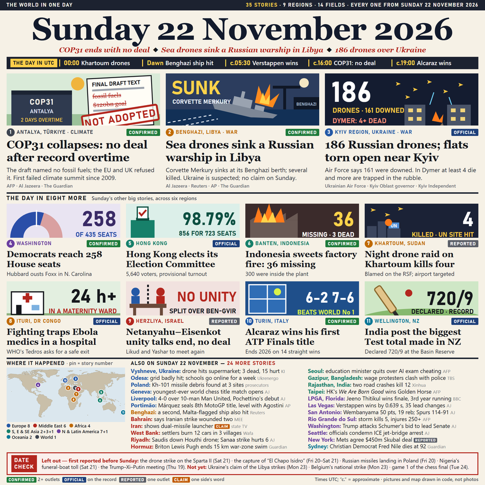

# world-front-1122

[](https://make.fun/bounty/news-image-20261122?utm_source=github&utm_medium=readme&utm_campaign=news-image-20261122)
[](https://make.fun/bounty/news-image-20261122/leaderboard?utm_source=github&utm_medium=readme&utm_campaign=news-image-20261122)
[](https://make.fun/bounty/news-image-20261122?utm_source=github&utm_medium=readme&utm_campaign=news-image-20261122)

Sunday 22 November 2026 on one page, made for the [make.fun](https://make.fun/?utm_source=github&utm_medium=readme&utm_campaign=news-image-20261122)
bounty "Sum up 22 November's world news in one image".



Three leads: COP31 in Antalya ends with no agreed text after two days of overtime; sea drones sink the
Russian corvette Merkury in Benghazi, Libya; and Russia sends 186 drones at Ukraine, tearing open a block
of flats in Dymer. Eight drawn cards follow, each with its number in large type (Democrats reach 258
House seats, Hong Kong's Election Committee vote, the Banten sweets-factory fire, drones over Khartoum,
Ebola medics trapped in Ituri, Netanyahu–Eisenkot talks fail, Alcaraz in Turin, India's 720/9 in
Wellington), then 24 short items, a UTC timeline, a world map keyed to the story numbers and a date
check naming what was left out because it was first reported before Sunday or came after it.

v2 trades the numbers strip and two small cards for four wider cards per row and larger type, so each
story still reads when the page is shrunk to about 300 px.

Each story carries a tag: CONFIRMED (two or more outlets), OFFICIAL (on the record), REPORTED (one
outlet) or CLAIM (one side's word). [docs/sources.md](docs/sources.md) lists the outlet behind every line.

## Build and run

- `src/front.html` is the page: HTML, CSS and inline SVG drawings written for it.
- `tools/build.py` fills in the world coastline from Natural Earth (public domain; set `NE_DIR` to a
  folder holding `ne_110m_land.geojson`, not committed), the map pins and the House seat ring, and
  writes `out/front.html`.
- `tools/render.ps1` screenshots it with headless Chrome at 2x and `tools/shrink.py` scales that to the
  1024 x 1024 `entry.png`.
- `main.ts` (Node 22, standard library only) checks `entry.png` and writes it to `/output/entry.png`:

```sh
mkdir -p out && MAKEFUN_OUTPUT_DIR=out node main.ts
```

No network is used at run time, and both runs write the same bytes.

## License

MIT, see [LICENSE](LICENSE).
